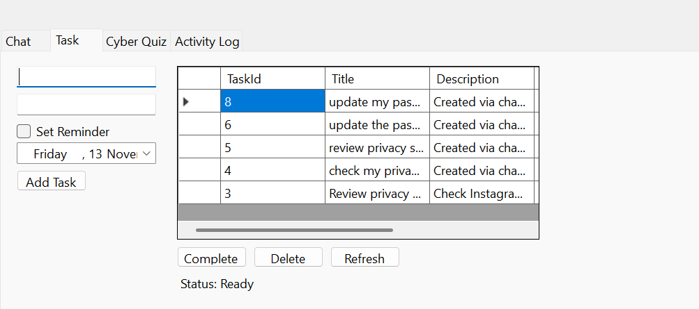

# PROG6221 Final POE - Cybersecurity Awareness Chatbot

## Student Information
- **Name:** Siphesihle Mirriam Mnisi
- **Student Number:** ST10499110
- **Course:** PROG6221 Programming 2A
- **Year:** 2026

---

## Project Description
This is the final integrated Portfolio of Evidence (POE) submission. It takes the foundational console chatbot from Part 1, transforms it into a fully interactive Windows Forms GUI in Part 2, and integrates a MySQL database, a cybersecurity quiz, NLP simulation, and an activity log in Part 3.

---

## Final Features

### Part 1 & 2 Features (Retained)
- 🎙️ **Voice Greeting**: Plays on launch using `System.Media`.
- 🎨 **ASCII Art Banner**: Visual cybersecurity identity.
- 🧠 **Memory & Sentiment**: Remembers user name, favorite topic, and detects user mood (worried, curious, frustrated).
- 🔑 **Keyword Recognition**: Responds to cybersecurity topics (passwords, phishing, privacy, etc.).

### Part 3 Features (New)
- 🗄️ **MySQL Task Assistant**: Add, view, complete, and delete cybersecurity tasks. Tasks persist in a MySQL database.
- ⏰ **Task Reminders**: Optional date/time reminders for tasks.
- 🎯 **Cyber Quiz**: A 5-question interactive quiz (Multiple choice and True/False) with immediate feedback and scoring.
- 🤖 **NLP Simulation**: Recognizes natural language commands in the chat. (e.g., "Remind me to check my privacy", "Start the cyber quiz", "Show my tasks").
- 📊 **Activity Log**: Tracks recent actions (tasks added, quiz completed, NLP commands used) and displays the most recent 5-10 items.

---

## Database Setup Instructions

To run this application, you must have MySQL installed on your computer.

1. Open **MySQL Workbench** and run the following SQL script to create the database and table:
```sql
CREATE DATABASE IF NOT EXISTS CyberSecurityBotDB;
USE CyberSecurityBotDB;

CREATE TABLE IF NOT EXISTS cyber_task (
    task_id INT AUTO_INCREMENT PRIMARY KEY,
    title VARCHAR(150) NOT NULL,
    description VARCHAR(500) NOT NULL,
    reminder_date DATETIME NULL,
    is_completed BOOLEAN NOT NULL DEFAULT FALSE,
    created_at TIMESTAMP DEFAULT CURRENT_TIMESTAMP
);
## Video Presentation
https://youtu.be/3jZwLZZ_mgw

---

## Evidence Screenshots

### Final GUI & Chat


### Task Assistant (Database Integration)


### Cyber Quiz & Immediate Feedback


### Activity Log


### GitHub CI/CD & Releases


   
